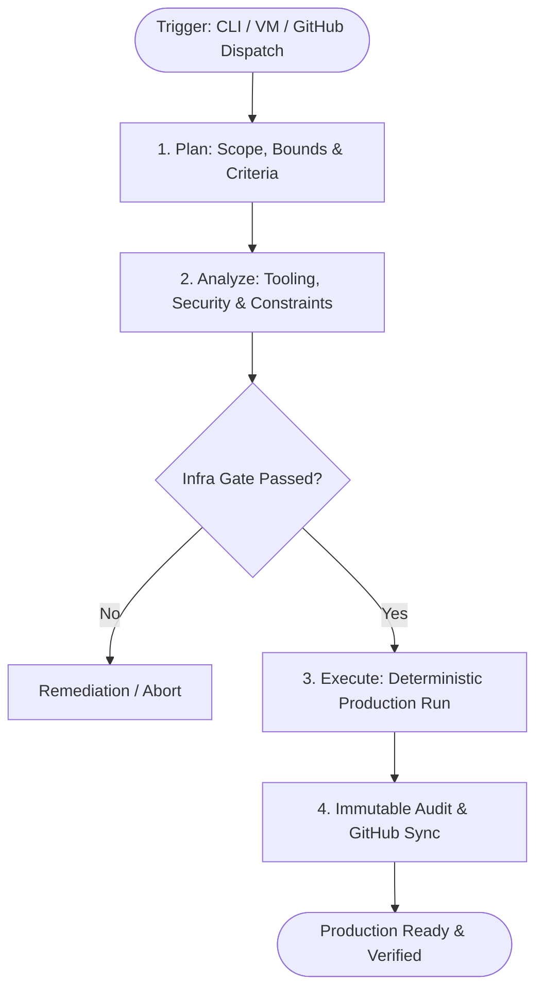

# ⚡ Agentic Infrastructure Hub (`agentic-infra-hub`)

Production-ready Forward Deployed Engineer (FDE) and AI Scientist execution system running on centralized VM, CLI, Docker, and GitHub (`gh`) infrastructure.

---

## Architecture & Governance



---

## Capabilities & Infrastructure Integration
- **Deterministic Pipeline**: Enforces **Plan $\rightarrow$ Analyze $\rightarrow$ Execute** lifecycle before any code mutations.
- **Pre-flight Constraint Gates**: Verifies Docker daemon, Python runtime, Git environment, and GitHub CLI authorization.
- **GitHub Centralization**: Dispatches tasks through GitHub Actions (`workflow_dispatch`), tracks runs via automated commit manifests, and records immutable JSONL audit logs.
- **Autonomous CLI/VM Execution**: CLI execution engine [`agentic_engine.py`](./agentic_engine.py) operates stand-alone or inside CI pipelines.

---

## Quickstart

### Run locally via CLI
```bash
python3 agentic_engine.py --task "Run full verification of telemetry pipeline"
```

### Trigger via GitHub Actions Dispatch
```bash
gh workflow run agentic_pipeline.yml -f task_description="Deploy model evaluation benchmark"
```

---

## Audit Logs & Manifests
- [`audit_trail.jsonl`](./audit_trail.jsonl): Append-only structured logs capturing timestamps, phases, and statuses.
- [`last_run_manifest.json`](./last_run_manifest.json): State of the most recent production run.
